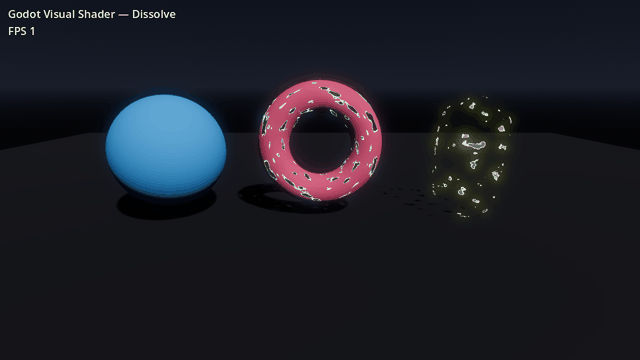
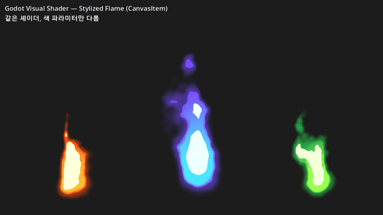
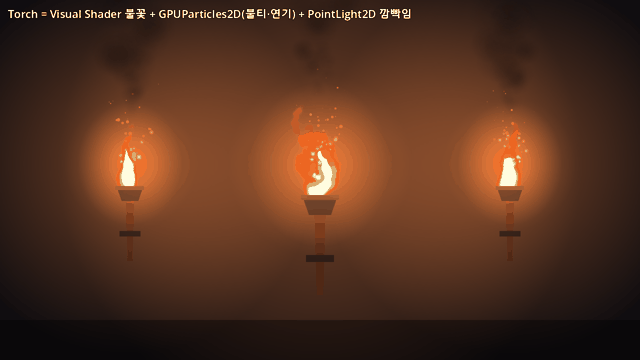
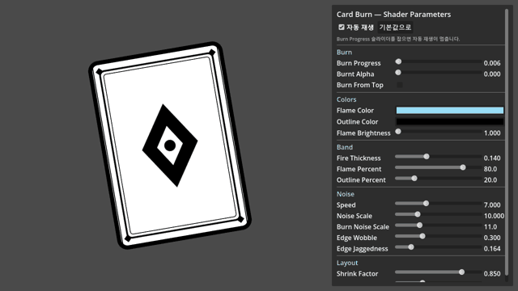

# Godot VFX 연구 — 01. Visual Shader (Shader Graph 대응)



## 결론: 됩니다

Godot에는 **Visual Shader**가 기본으로 들어 있습니다. Unity Shader Graph처럼 노드를 연결해서 셰이더를 만드는 에디터예요. 플러그인을 따로 깔 필요가 없습니다.

- 머티리얼의 `Shader` 칸 → **New VisualShader**를 고르고 클릭하면 노드 에디터가 열립니다.
- 그래프는 **GLSL 비슷한 Godot 셰이더 코드로 실시간 변환**됩니다. 에디터 상단의 *Show Generated Code*로 확인할 수 있어요.
- 노드로 막히는 부분은 **Expression 노드**(코드 한 덩어리)나 **Custom Node**(GDScript로 직접 만드는 노드)로 해결합니다. 아예 텍스트 `.gdshader`로 바꿔서 쓸 수도 있습니다.

### Shader Graph ↔ Visual Shader 대응표

| Unity Shader Graph | Godot Visual Shader |
|---|---|
| Master Stack (Base Color, Emission, Alpha, Alpha Clip Threshold) | **Output** 노드 (`albedo`, `emission`, `alpha`, `alpha_scissor_threshold`) |
| Blackboard 프로퍼티 | **Parameter** 노드 (FloatParameter, ColorParameter, Texture2DParameter …) |
| Sample Texture 2D | **Texture2D** 노드 |
| UV / Time / Position / Normal 노드 | **Input** 노드 (`uv`, `time`, `vertex`, `normal` …) |
| Multiply / Add / One Minus / Smoothstep / Step | FloatOp / VectorOp / FloatFunc(OneMinus) / SmoothStep / Step |
| Split | VectorDecompose |
| Fresnel Effect | **Fresnel** 노드 |
| Sub Graph | **VisualShaderNodeCustom** (GDScript 클래스) 또는 Expression 노드 |
| Custom Function 노드 | **Expression** 노드 / Global Expression |
| Vertex / Fragment 스테이지 | 그래프 상단 탭: **Vertex / Fragment / Light** (Light 함수는 Godot에만 있음) |
| Particle shader(VFX Graph 일부) | Visual Shader 모드를 **Particles**로 (Start / Process 탭) |
| `Material.SetFloat("_X", v)` | `material.set_shader_parameter("x", v)` |

Godot에 더 있는 것: 2D(CanvasItem)·3D(Spatial)·파티클·하늘(Sky)·포그(Fog) 셰이더를 **모두 같은 노드 에디터**로 만들 수 있습니다.
부족한 것: 노드 라이브러리가 Shader Graph보다 작습니다(Voronoi나 Gradient Noise 같은 프로시저럴 노이즈 노드가 없어서 NoiseTexture2D 리소스로 대신합니다). 노드 프리뷰도 Unity보다 단순합니다.

---

## 만든 예제: Dissolve (디졸브)

게임에서 가장 흔히 쓰는 Shader Graph 예제입니다. 몬스터가 죽거나 소환될 때, 아이템이 사라질 때 씁니다.

```
UV ─► × noise_tiling ─► Texture2D(Noise) ─► .r ──┬──────────────────────► Output.alpha
                                                 │
dissolve_amount ─────────────────────────────────┼──────────────────────► Output.alpha_scissor_threshold
        │                                        ▼
        ├──► + edge_width ──► SmoothStep(d, d+w, noise) ─► OneMinus = edge
        │                                                       │
        │                    edge × edge_intensity × edge_color ─► Output.emission  (HDR → Glow)
        └─                   base_color × (1 - edge) ───────────► Output.albedo     (타는 부분은 검게)
```

- **Alpha Clip**: `alpha = noise`, `threshold = dissolve_amount`로 두면 노이즈 값이 임계값보다 낮은 픽셀이 잘려 나갑니다. 불투명 파이프라인을 그대로 써서 **그림자도 같이 디졸브됩니다**.
- **가장자리 빛**: 임계값 바로 위 구간만 `SmoothStep`으로 띠를 만들고, `edge_intensity`(기본 6)를 곱해서 HDR 값으로 Emission에 넣습니다. WorldEnvironment의 Glow가 이 값을 받아서 빛번짐을 만듭니다.

### 파라미터

| 이름 | 기본값 | 설명 |
|---|---|---|
| `dissolve_amount` | 0 | 0이면 온전, 1이면 완전 소멸 |
| `edge_width` | 0.08 | 빛나는 가장자리 두께 |
| `edge_color` / `edge_intensity` | 주황 / 6 | 가장자리 색과 HDR 세기 |
| `base_color` | 파랑 | 본체 색 |
| `noise_tiling` | 2 | 노이즈 반복 횟수 (구멍 크기) |

### 게임 코드에서 사용하기

```gdscript
# 적이 죽을 때 1초 동안 사라지게 하기
var mat := $Mesh.material_override.duplicate() as ShaderMaterial  # 개체별로 따로 움직이게 복제
$Mesh.material_override = mat
create_tween().tween_method(
    func(v): mat.set_shader_parameter("dissolve_amount", v), 0.0, 1.0, 1.0)
```

---

## 만든 예제 2: 스타일라이즈드 불꽃 (2D, 텍스처 없음)



레퍼런스는 시안에서 보라로 넘어가는 툰 스타일 영혼불입니다. 이 셰이더는 **이미지 텍스처를 한 장도 쓰지 않고** 노이즈 리소스 두 장과 수식 노드만으로 만들었습니다. CanvasItem(2D) 모드이고, `ColorRect`나 `Sprite2D`에 머티리얼만 넣으면 됩니다.

```
UV ─► 노이즈A(크게, 위로 흐름) ─► x 좌표를 흔듦 (위로 갈수록 크게) ─┐
                                                                    ▼
      물방울 거리장: length(dx·aspect·(1+up·taper), dy·(위쪽이면 stretch)) / radius
                                                                    │  field = 1 - dist
UV ─► 노이즈B(중간, 더 빠르게 위로) × erosion × up ─► field 에서 뺌 ─┘  (위쪽이 찢어져 덩어리로 떨어짐)
                                                                    ▼
          smoothstep 단계 나누기:  body(알파) · rim(보라 테두리) · core(흰 코어) · glow(바깥 번짐)
          색:  mix(bottom_color, top_color, 세로 그라데이션) → 테두리 보라 → 코어 흰색
```

핵심은 **거리장(field)을 하나 만들고, 이 값을 여러 임계값으로 잘라서 층을 나누는 것**입니다. 같은 값에서 body, 테두리, 코어, 글로우 네 층을 뽑아냅니다. 툰 이펙트에서 가장 많이 쓰는 패턴입니다.

| 파라미터 | 역할 |
|---|---|
| `scroll_speed` / `time_offset` | 흐르는 속도 / 여러 개를 놓을 때 서로 다르게 움직이게 하는 값 |
| `distortion` | S자 일렁임 세기 |
| `radius` / `stretch` / `taper` / `center_y` | 물방울 크기 / 위쪽 길이 / 위쪽 좁아짐 / 바닥 위치 |
| `erosion` | 위쪽이 갉아먹혀 떨어져 나가는 정도 |
| `edge_softness` / `rim_width` / `core_threshold` | 외곽선 선명도 / 보라 테두리 두께 / 흰 코어 크기 |
| `glow_width` / `glow_alpha` | 바깥 번짐 범위와 세기 |
| `bottom_color` / `top_color` / `core_color` / `glow_color` | 색. 데모의 주황 불, 초록 독불은 색만 바꾼 것입니다 |
| `aspect` | 사각형의 가로/세로 비율 (기본 1:2 = 0.5) |

> 함정: Visual Shader의 Texture 노드가 쓰는 내장 sampler에는 반복(repeat) 설정이 없습니다. 그래서 2D에서 UV를 스크롤하면 텍스처 끝에서 값이 멈춰(clamp) 애니메이션이 정지합니다. 노드의 `texture_repeat`를 켜도 소용없었습니다. 그래서 그래프 안에서 **Fract 노드로 UV를 감싸서** 해결했습니다(`vs_builder.gd`의 `sample_r`). 노이즈가 seamless라서 이음새는 보이지 않습니다.

---

## 만든 예제 3: 횃불 (Visual Shader 불꽃 + 파티클 + 2D 라이트)



`vfx/torch/torch.tscn`은 재사용할 수 있는 **프리팹**입니다. 데모 씬(`scenes/torch_demo.tscn`)은 이걸 크기만 바꿔 세 개 배치했습니다.

| 레이어 (아래→위 그리는 순서) | 노드 | 하는 일 |
|---|---|---|
| 조명 | `PointLight2D` (`Light`) | 주황 빛으로 벽을 비춥니다. `torch.gd`가 FastNoiseLite로 밝기와 범위를 흔들어 **깜빡임**을 만듭니다 |
| 손잡이·받침 | `Polygon2D` | 조명을 받는 소품입니다 |
| 연기 | `GPUParticles2D` (`Smoke`) | 어두운 반투명 덩어리가 회전하며 올라갑니다. 크기는 커지고, 알파는 0에서 0.2로 갔다가 0으로 돌아갑니다 |
| 후광 | `Sprite2D` (`Halo`) | 가산 블렌드 방사형 그라데이션입니다. 2D에서 블룸이 있는 것처럼 보이게 합니다 |
| 불꽃 | `ColorRect` + **flame.tres** | 앞에서 만든 Visual Shader를 주황색으로 씁니다. 불꽃 셰이더는 `unshaded`로 바꿔 어두운 화면 톤에 같이 어두워지지 않게 했습니다 |
| 컵 | `Polygon2D` | 불꽃 아래쪽을 가려서 "컵 안에서 타는" 느낌을 줍니다 |
| 불티 | `GPUParticles2D` (`Embers`) | 가산 블렌드, unshaded. 색은 흰노랑→주황→빨강→투명, 크기는 점점 작아지고, 약한 난류로 흔들립니다 |

- 어두운 분위기는 씬의 `CanvasModulate`(전체를 어둡게) + 횃불마다 있는 `PointLight2D`로 만듭니다. 발광체(불꽃, 불티, 후광)만 unshaded라 어둠 속에서도 밝게 보입니다.
- 이미지 파일은 하나도 없습니다. 파티클과 조명의 텍스처는 모두 `GradientTexture2D`(방사형)이고, 색 변화는 `GradientTexture1D`, 크기 변화는 `CurveTexture`입니다.
- `torch.gd`는 인스턴스마다 불꽃의 `time_offset`과 깜빡임 시드를 다르게 줘서, 여러 개를 놓아도 똑같이 움직이지 않게 합니다.

**튜닝하며 알게 된 것**
- **ParticleProcessMaterial의 turbulence influence가 조금만 높아도 초기 속도가 거의 없어집니다.** 불티는 influence 0.08~0.2에서 불꽃 주변에만 맴돌았고, 연기는 0.03~0.08에서도 한 자리에 뭉친 공처럼 멈춰 있었습니다. 불티는 0.02~0.06으로 낮췄고, 연기는 난류를 끄고 회전과 퍼짐(spread)만으로 퍼지게 했습니다.
- 연기 색이 조명 받은 벽과 밝기가 비슷하면 보이지 않습니다. **벽보다 어둡게** 해서 실루엣으로 보이게 했습니다. 생성 직후에는 투명하게 두고 올라간 뒤에 진해지게 해야 불꽃 위에 검은 얼룩처럼 뭉치지 않습니다.
- 불꽃 셰이더의 노이즈는 fract로 감싸서 주기가 1입니다. 그래서 `time_offset`으로 시간만 밀면 금방 같은 모양이 반복되고, 두 횃불이 똑같이 보이기도 했습니다. 지금은 `time_offset`이 노이즈의 **가로 샘플 위치**도 바꾸고, 천천히 옆으로 흐르는 드리프트도 더해서 인스턴스마다 다른 모양이 오래 이어집니다.

---

## 만든 예제 4: 카드 번 (2D 텍스트 셰이더 + 실시간 파라미터 패널)



레퍼런스는 인스타그램 undefined.team의 "Dissolve/burn shader in our game" 릴스입니다. 카드가 아래에서부터 타 들어가고, 연소선에 **하늘색 불꽃 띠**와 그 아래 **검은 외곽선**이 붙어 일렁입니다. 영상 인스펙터에 보이던 파라미터 구성을 그대로 따라 만들었습니다. 이 예제는 Visual Shader가 아니라 **텍스트 셰이더**(`.gdshader`)입니다.

- `scenes/card_burn_demo.tscn`을 열고 **F6**으로 실행하면 오른쪽 패널에서 슬라이더로 모든 값을 조절할 수 있습니다. 패널은 셰이더 uniform 목록을 읽어 자동으로 만들기 때문에, uniform을 추가하면 슬라이더도 저절로 생깁니다.
- 에디터에서는 `Card` 노드를 선택한 뒤 인스펙터 **Material → Shader Parameters**에서 영상처럼 값을 바로 바꿀 수 있습니다. 셰이더가 `TIME`을 쓰기 때문에 에디터 뷰포트에서도 불꽃이 움직입니다.
- 층 구조(탄 쪽 → 남은 카드 쪽): 탄 부분(투명 또는 그을음) | 외곽선 | 불꽃 | 카드

| 파라미터 | 기본값 | 설명 |
|---|---|---|
| `burn_progress` | 0 | 0이면 온전한 카드, 1이면 완전히 타서 사라짐 |
| `burnt_alpha` | 0 | 탄 부분에 남는 그을음 잔상의 불투명도 |
| `burn_from_top` | off | 켜면 위에서 아래로 탑니다 |
| `flame_color` / `outline_color` | 하늘색 / 검정 | 불꽃 띠와 외곽선 색 |
| `flame_brightness` | 1 | 불꽃 HDR 배율 (2D Glow를 켠 씬에서 번짐이 생김) |
| `fire_thickness` | 0.14 | 띠 전체 두께 (카드 높이 대비) |
| `flame_percent` / `outline_percent` | 80 / 20 | 띠 안에서 불꽃과 외곽선이 차지하는 비율 |
| `speed` | 7 | 불꽃 일렁임 속도 |
| `noise_scale` | 10 | 불꽃 끝(혀 모양) 노이즈의 촘촘함 |
| `burn_noise_scale` | 11 | 연소선 노이즈의 촘촘함 |
| `edge_wobble` | 0.3 | 연소선의 큰 물결 |
| `edge_jaggedness` | 0.164 | 연소선의 잔 톱니와 흘러내림 |
| `roughness` | 0.15 | 노이즈 잔 디테일 양. 0이면 매끈한 덩어리, 1이면 삐죽삐죽 거친 가장자리 |
| `edge_softness` | 1.5 | 경계선 블러 폭 (화면 픽셀). 클수록 가장자리가 부드럽게 번집니다 |
| `shrink_factor` | 0.85 | 쿼드 안에서 카드를 줄이는 비율. 남는 여백으로 불꽃이 삐져나갑니다 |
| `corner_radius` | 30 | 카드 모서리 둥글기 (불꽃 마스크용, 텍스처 픽셀 단위) |

> 메모: 처음엔 흔한 실수 해시(`fract(p * 123.34)` 계열)를 썼더니, GPU 반올림 오차 때문에 노이즈 격자 경계마다 값이 미세하게 어긋나 연소선에 **세로 단차**가 생겼습니다. 정수 해시(`uvec2` 곱셈 + XOR)로 바꿔서 해결했습니다.

```gdscript
# 카드를 1초 동안 태워서 없애기
var mat := $Card.material.duplicate() as ShaderMaterial
$Card.material = mat
create_tween().tween_method(
    func(v): mat.set_shader_parameter("burn_progress", v), 0.0, 1.0, 1.0)
```

---

## 파일 구성

| 경로 | 내용 |
|---|---|
| `vfx/dissolve/dissolve.tres` | **VisualShader 그래프** (더블클릭하면 노드 에디터가 열림) |
| `vfx/dissolve/dissolve_material.tres` | 위 셰이더를 쓰는 ShaderMaterial |
| `scenes/dissolve_demo.tscn` / `.gd` | 디졸브 데모 씬 (메인 씬, F5로 실행) |
| `vfx/flame/flame.tres` / `flame_material.tres` | **불꽃 VisualShader 그래프**와 머티리얼 |
| `scenes/flame_demo.tscn` | 불꽃 데모 씬 (열어서 F6으로 실행) |
| `vfx/torch/torch.tscn` / `torch.gd` | **횃불 프리팹** (불꽃 + 불티/연기 파티클 + 깜빡이는 라이트) |
| `scenes/torch_demo.tscn` | 횃불 데모 씬 (열어서 F6으로 실행) |
| `tools/build_dissolve_shader.gd`, `tools/build_flame_shader.gd` | 그래프를 코드로 조립해서 `.tres`로 저장하는 생성기 |
| `tools/vs_builder.gd` | 생성기 공용 헬퍼 (노드 생성, 연결, 수식형 `fop`/`sstep`/`mix3` 등) |
| `vfx/card_burn/card_burn.gdshader` / `card.png` | **카드 번 셰이더** (텍스트)와 카드 텍스처 |
| `scenes/card_burn_demo.tscn` / `.gd` | 카드 번 데모 씬 + 자동 생성 파라미터 패널 (열어서 F6으로 실행) |
| `tools/build_card_texture.gd` | 카드 텍스처(`card.png`) 생성기 |
| `docs/` | 미리보기 GIF와 스크린샷 |

그래프 생성기를 다시 돌리려면 아래처럼 실행합니다. 에디터에서 그래프를 손으로 고쳤다면 다시 돌리지 마세요. 손으로 고친 내용이 덮어써집니다.

```
Godot.exe --headless --path . --script res://tools/build_dissolve_shader.gd
Godot.exe --headless --path . --script res://tools/build_flame_shader.gd
```

> 메모: 스크립트에서는 Output 노드 포트 번호를 조회할 수 없습니다. 그래서 생성기는 임시 셰이더를 만들어 생성된 코드에서 `EMISSION =` 같은 줄을 찾는 방식으로 포트 번호를 알아냅니다(`_output_port`). Godot 버전이 바뀌어 포트 순서가 달라져도 그대로 동작합니다.

---

## Godot VFX 연구 로드맵 (다음 단계 후보)

1. **Visual Shader 기본기**: ✅ Dissolve (3D), ✅ 스타일라이즈드 불꽃 (2D)
   - 다음 후보: Fresnel 실드/포스필드, UV 스크롤 슬래시 트레일, 피격 플래시(2D), 홀로그램
2. **GPUParticles3D/2D + ParticleProcessMaterial**: ✅ 횃불의 불티·연기 (2D). 다음 후보: 폭발, 3D 파티클 (Unity Particle System에 해당)
3. **파티클 셰이더**: Visual Shader Particles 모드로 커스텀 움직임 (VFX Graph에 가까운 영역)
4. **포스트 프로세싱**: WorldEnvironment(Glow, Fog, Volumetric Fog, SSR) + 풀스크린 CanvasItem 셰이더
5. **Compositor Effects (4.3+)**: 컴퓨트 셰이더로 커스텀 렌더 패스 (URP Renderer Feature에 해당)
6. **Decal / Trail / Mesh 기반 이펙트**: 검기, 마법진, 바닥 장판
