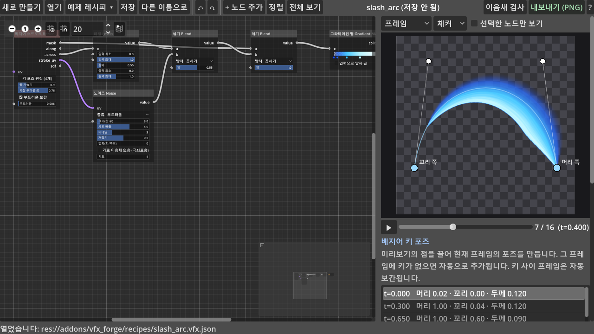
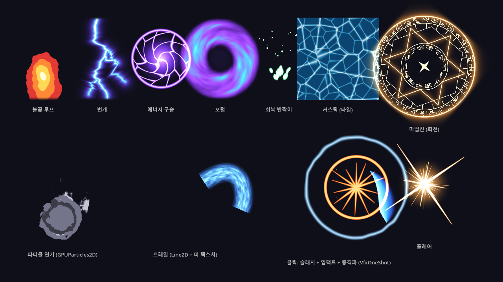
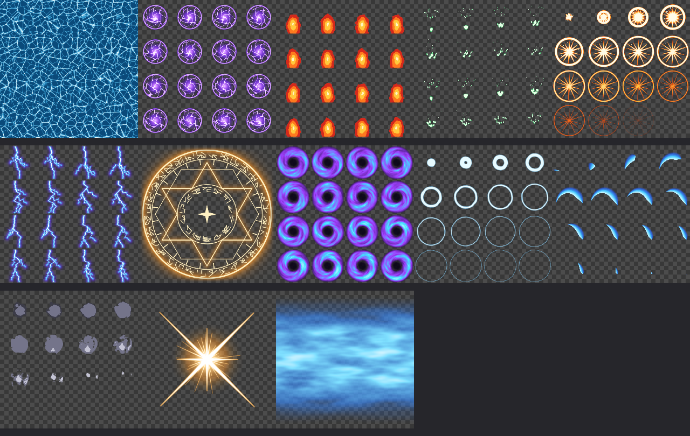

# VFX Forge

노드 그래프로 **스타일라이즈드 VFX 텍스처와 스프라이트 시트(플립북)** 를 만들어 PNG 로 내보내는 Godot 4 에디터 툴입니다.
Unity 에셋 *VFXGen* 의 공개된 기능 설명을 참고해서 Godot 용으로 처음부터 새로 만들었습니다 (원본 코드는 보지도 쓰지도 않았습니다).



## 열기

- **에디터**: 프로젝트 설정 → 플러그인에서 *VFX Forge* 를 켜면 상단 2D / 3D / Script 옆에 **VFX Forge** 탭이 생깁니다.
- **파일시스템 독**: 레시피(`.vfx.json`)나 VFX Forge 로 내보낸 PNG 를 우클릭 → *VFX Forge 에서 열기*. PNG 는 그걸 만든 레시피를 찾아서 엽니다.
- **단독 실행**: `addons/vfx_forge/vfx_forge_app.tscn` 을 열고 F6. 에디터 전용 클래스를 쓰지 않아 게임처럼 실행해도 동작합니다.

## 작업 흐름

1. 툴바 **예제 레시피** 에서 비슷한 것을 고르거나 **새로 만들기**.
2. 노드를 고치며 오른쪽 미리보기로 확인합니다. 숫자 칸은 좌우로 드래그하고, 클릭하면 직접 입력할 수 있습니다.
3. 오른쪽 아래 **내보내기 설정**: 프레임 크기, 격자, 루프, 용도, PNG 경로를 정합니다.
4. **내보내기 (PNG)** → 시트 PNG, 임포트 설정, `_frames.tres`, `_particle.tres` 가 생깁니다.
5. **저장** 으로 레시피를 `res://vfx_recipes/` 에 남겨두면 나중에 다시 고칠 수 있습니다.

| 조작 | 방법 |
|---|---|
| 노드 추가 | 그래프 빈 곳 우클릭, 또는 포트를 빈 곳으로 끌어 놓기 (놓은 포트에 자동 연결) |
| 연결 끊기 | 입력 포트를 끌어서 빈 곳에 놓기 |
| 삭제 / 복제 | Delete / Ctrl+D |
| 실행 취소 / 다시 실행 | Ctrl+Z / Ctrl+Shift+Z (또는 툴바 ↶ ↷) |
| 재생 / 정지 | 스페이스, 또는 타임라인 드래그 |
| 노드 하나만 보기 | 미리보기 위 *선택한 노드만 보기* |

포트 색: **보라 = 좌표(UV)**, **회색 = 흑백 값**, **주황 = 색**. 타입이 달라도 연결하면 자동으로 변환됩니다.
파라미터 왼쪽에 포트가 있으면 다른 노드(시간, 타이밍 등)를 꽂아 애니메이션할 수 있습니다.

## 시간과 루프

- **시간 노드의 t**: 첫 프레임 0 → 마지막 프레임 1.
- **루프를 켠 경우**: 마지막 프레임 다음이 첫 프레임이 되도록 `t = i / N` 입니다. 흐름 속도나 노이즈 변화 횟수는 정수로 반올림되어 이음새 없이 돌아갑니다.
- **루프를 끈 경우 (1회 재생: 슬래시, 임팩트)**: `t = i / (N-1)` 이라 마지막 프레임이 정확히 1 입니다.
- **타이밍(Ease) 노드**: 요소마다 등장 구간을 다르게 줄 때 씁니다. 예: 고리는 0~0.55 에 퍼지고, 전체는 0.45~1 에 사라짐.

## 베지어 키 포즈 (슬래시)

**베지어 스트로크** 노드를 선택하면 미리보기에 제어점 4개가 나타납니다.

- **포즈 만들기**: 타임라인을 원하는 프레임으로 옮기고 점을 끌면 그 프레임에 키가 생깁니다. 키 사이 프레임은 자동으로 보간됩니다.
- **키별 값**: 오른쪽 *베지어 키 포즈* 패널에서 키마다 **머리**(그려진 끝), **꼬리**(지워지는 끝), **두께**, **시간**을 조절합니다.
- **곡선 좌표 출력**: `stroke_uv` 는 곡선을 따라가는 좌표입니다. 노이즈에 꽂으면 검기를 따라 흐르는 결이 생깁니다.

## 용도와 타일링

| 용도 | 설명 |
|---|---|
| 이펙트 | 반복하지 않는 단독 이펙트. 출력 노드의 **가장자리 페이드**가 테두리 알파를 0 으로 줄여 글로우가 네모나게 잘리지 않게 합니다 |
| 띠 Strip | 가로로 이음새 없이 반복됩니다 (Line2D 트레일, 메시 트레일) |
| 타일 Tile | 상하좌우로 반복됩니다 (바닥, 수면, 스크롤 배경) |

- **자동 이음새 처리**: 띠나 타일을 고르면 노이즈와 셀 노이즈는 정수 주기로 맞춰지고, 도형은 가장자리를 넘으면 반대편에서 나옵니다.
- **이음새 검사 버튼**: 가장자리를 비교하고, 이음새가 있으면 처음으로 이음새를 만든 노드를 선택해 줍니다. 선형 그라데이션처럼 원래 반복되지 않는 노드가 대표적인 원인입니다.
- **극좌표에서의 이음새**: 극좌표로 감싼 노이즈는 각도 0/1 경계에 이음새가 생깁니다. 노이즈의 *가로 이음새 없음* 을 켜세요.

## 게임에서 쓰기

내보내기 하면 PNG 옆에 아래 파일이 같이 생깁니다.

| 파일 | 쓰는 곳 |
|---|---|
| `이름.png` (+ `.import`) | 2D 프리셋은 무손실/밉맵 없음, 3D 프리셋은 VRAM 압축 + 밉맵으로 자동 임포트 |
| `이름_frames.tres` | **AnimatedSprite2D** 의 Sprite Frames. FPS 와 루프 여부가 들어 있습니다 |
| `이름_particle.tres` | **GPUParticles2D** 의 Material (CanvasItemMaterial, 플립북 칸 수 설정). 3D 프리셋이면 빌보드 StandardMaterial3D |

```gdscript
# 1회 재생 이펙트: 재생이 끝나면 스스로 지워진다
VfxOneShot.spawn(self, preload("res://vfx_textures/impact_burst_frames.tres"), hit_pos, 0.35)
VfxOneShot.spawn(self, preload("res://vfx_textures/slash_arc_frames.tres"), pos, 0.5, attack_dir.angle())
```

- **파티클 플립북**: `ParticleProcessMaterial` 의 **Animation → Speed Min/Max = 1** 로 두면 파티클 수명 동안 시트를 한 번 재생합니다.
- **트레일**: `Line2D.texture_mode = Tile` 과 `texture_repeat = Enabled` 로 띠 텍스처를 씁니다.
- **데모 씬**: `scenes/vfx_forge_demo.tscn` 에 위 사용법이 모두 들어 있습니다. 클릭하면 타격 이펙트가 나옵니다.



## 예제 레시피 (13개)



`caustics_tile`(타일 루프) · `energy_orb` · `fire_loop`(툰 불꽃) · `heal_sparkles` · `impact_burst`(1회) · `lightning_bolt` · `magic_circle`(1024 단일) · `portal_swirl` · `shockwave`(1회) · `slash_arc`(베지어 1회) · `smoke_puff`(1회) · `star_flare`(단일) · `trail_strip`(가로 반복)

예제는 `tools/build_vfx_recipes.gd` 가 코드로 만듭니다. 노드 연결 예시로 읽기 좋습니다.
예제를 열어 고친 뒤 **저장**하면 원본 대신 새 경로를 묻습니다.

## 노드 (38종)

| 분류 | 노드 |
|---|---|
| 좌표 | UV, 변형, 반복, 극좌표, 소용돌이, 만화경, 흐름(스크롤), 일그러짐(워프) |
| 모양 | 원, 다각형/별, 사각형, 선, 호, 그라데이션, 빛줄기, 파편, 베지어 스트로크, 번개, 룬 고리 |
| 패턴 | 노이즈(부드러움/능선/난류, 주기성), 셀(Voronoi) |
| 시간 | 시간, 타이밍(Ease) |
| 수학 | 값, 연산, 섞기, 레벨, 경계(Step), 띠(Band), 단계(Posterize), 글로우 |
| 색 | 색, 색 입히기, 그라데이션 맵, 색 섞기, 알파, 색 보정 |
| 출력 | 출력 (RGBA / 프리멀티 / 흑백 마스크 / 알파 마스크, 가장자리 페이드) |

모양 노드는 `mask`(0..1) 와 `sdf`(부호 거리) 를 함께 냅니다. sdf 를 **글로우** 노드에 꽂으면 바깥으로 퍼지는 빛이 됩니다.

## 구조

| 경로 | 내용 |
|---|---|
| `core/node_library.gd` | 노드 정의 (입력, 파라미터, 출력, GLSL 템플릿). 노드를 추가하려면 여기에 항목 하나를 넣으면 됩니다 |
| `core/compiler.gd` | 그래프 → canvas_item 셰이더. 숫자/색 파라미터는 uniform 이라 값만 바뀌면 재컴파일하지 않습니다 |
| `shaders/vfx_lib.gdshaderinc` | 노이즈, SDF, 베지어, 번개, 룬 등 셰이더 함수 |
| `core/renderer.gd` | SubViewport 렌더러. 시트 전체를 한 번의 드로우로 그립니다 (셰이더가 픽셀 위치로 프레임 번호와 시간을 계산) |
| `core/exporter.gd` | PNG 저장, `.import` 설정, SpriteFrames/파티클 머티리얼 생성, 이음새 검사 |
| `core/graph.gd` | 레시피 데이터와 JSON 저장/불러오기 |
| `ui/` | 메인 패널, 노드 뷰, 미리보기, 숫자 슬라이더, 그라데이션 편집기 |
| `runtime/vfx_one_shot.gd` | 게임용 1회 재생 헬퍼 |

명령줄 도구 (GPU 가 필요해서 `--headless` 없이 실행):

```
Godot.exe --path . --script res://tools/vfx_forge_cli.gd -- --recipes=all            # 모든 예제를 export_path 로 내보내기
Godot.exe --path . --script res://tools/vfx_forge_cli.gd -- --test-nodes --out-dir=C:/tmp/n   # 노드 전체 렌더 점검
Godot.exe --path . --script res://tools/vfx_forge_selftest.gd                        # UI 동작 자기 점검
```

## 알려진 한계

- **출력 형식**: 8비트 PNG 만 지원합니다. EXR/HDR 과 PBR 세트(노멀, 러프니스)는 범위 밖입니다.
- **블러**: 한 번의 셰이더 패스로 그리기 때문에 블러 같은 주변 픽셀 참조 효과는 없습니다. 부드러운 빛은 도형의 부드러움과 글로우 노드로 만듭니다.
- **시트 크기**: 최대 8192 px 입니다 (예: 1024 px × 8×8 칸).
